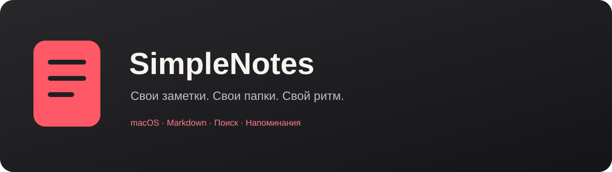

<p align="center"></p>

<p align="center"><a href="https://github.com/kip0VV/SimpleNotes/releases/latest"><strong>Скачать для Mac</strong></a> · <a href="docs/guide.md">Подробная инструкция</a> · <a href="#сборка">Сборка</a></p>

**SimpleNotes** — небольшой нативный блокнот: быстро запиши мысль, разложи записи по папкам и найди нужное через поиск. Заметки хранятся обычными Markdown-файлами на твоём Mac.

**macOS 13+ · Apple Silicon и Intel · Русский интерфейс · Локальное хранение**

## Начать пользоваться

1. Скачай DMG из [последнего релиза](https://github.com/kip0VV/SimpleNotes/releases/latest).
2. Открой образ и перетащи SimpleNotes в **Программы**.
3. Запусти приложение и выбери папку для заметок.
4. Нажми **+ Новая заметка**, напиши текст и сохрани его через **⌘Enter**.

Сборки пока распространяются без нотариализации Apple. Если macOS блокирует первый запуск, порядок открытия описан в [инструкции](docs/guide.md#первый-запуск-и-macos).

> Ветка `main` может опережать опубликованный релиз. Описанные ниже графитовая тема и новый режим быстрой записи доступны в текущих исходниках; состав готовой сборки смотри в описании релиза.

## Два режима

| Обычное окно | Быстрая запись |
| --- | --- |
| Название, текст, папки и поиск. | Маленькое окно: папка, поле «Запиши мысль…» и статус сохранения. Рядом с «⋯» — кнопка «Основное окно» с текущей горячей клавишей. |
| Форматирование значками и предпросмотр Markdown. | Системная горячая клавиша открывает запись из другого приложения. |
| **⌘Enter** сохраняет заметку. | Текст сохраняется автоматически после короткой паузы; название берётся из первой строки. |
| **+ Тема** создаёт папку для записей. | **⌘⇧Enter** или **⋯ → Открыть обычное окно** продолжает ту же запись в большом окне. |

Системное сочетание быстрой записи назначается в **Настройки → Горячие клавиши**. Оно не назначено по умолчанию. В маленьком окне форматирование находится в **⋯**.

## Основные возможности

- **Папки и поиск:** вложенные темы, поиск по названию и тексту, недавние записи.
- **Markdown и задачи:** жирный, курсив, списки, ссылки, код и интерактивные галочки в предпросмотре.
- **Формулы LaTeX:** `$…$` и `\(…\)` в строке, `$$…$$` и `\[…\]` отдельным блоком. Отрисовка в Markdown-предпросмотре работает без интернета.
- **Напоминания:** дата, время, повтор и отдельный список всех напоминаний. Высота блока меняется перетаскиванием верхней границы; уменьшение до минимума скрывает его. Вернуть блок можно через **⋯ → Основные → Скрыть меню напоминаний**.
- **Оформление:** светлая, тёмная, системная и **Графит · мягкий голубой**; шрифт, масштаб и импорт своего стиля редактора.
- **Файлы под твоим контролем:** `.md`, `.markdown` и `.txt`, перенос и переименование, удаление в Корзину. Облачная синхронизация и аккаунт не нужны.

## Под себя

Открой **⌘,** или **⋯** внизу правой панели.

В **Основных** выбираются тема, шрифт, папка заметок и поведение бокового меню. **Графит** сочетает чёрно-серые поверхности и приглушённые голубые акценты. Свой JSON-стиль меняет шрифт и цвета текста; [пример файла](docs/styles/dark.json) и [формат](docs/guide.md#быстрая-запись-и-стиль-редактора) есть в инструкции.

В **Горячих клавишах** можно переназначить команды приложения и системную команду быстрой записи.

| Действие | По умолчанию |
| --- | --- |
| Новая заметка | **⌘N** |
| Сохранить | **⌘Enter** |
| Из быстрой записи в обычное окно | **⌘⇧Enter** |
| Поиск | **⌘F** |
| Жирный / курсив / ссылка | **⌘B / ⌘I / ⌘K** |
| Предпросмотр / редактор | **⌘⇧P / ⌘E** |
| Настройки | **⌘,** |

[Все возможности, жесты и хранение данных →](docs/guide.md)

## Сборка

На Mac с установленными Command Line Tools:

```sh
git clone https://github.com/kip0VV/SimpleNotes.git
cd SimpleNotes
./scripts/build.sh --native
open build/SimpleNotes.app
```

- `./scripts/build.sh --universal` — приложение для Apple Silicon и Intel.
- `./scripts/package.sh` — DMG и ZIP в `build/`.
- `./scripts/test.sh` — регрессионные проверки. [Что проверяется](docs/testing.md).

Приложение использует Swift, AppKit и WebKit. Markdown-рендерер включён в ресурсы. Intel-сборка компилируется для macOS 13+, запуск на реальном Intel Mac ещё требует проверки.

Ошибка или идея? [Создай Issue](https://github.com/kip0VV/SimpleNotes/issues) и укажи версию приложения, macOS и шаги воспроизведения.

Markdown-рендеринг: [markdown-it, MIT](ThirdPartyLicenses/markdown-it.txt). Формулы: [KaTeX 0.16.21, MIT](ThirdPartyLicenses/katex.txt).
