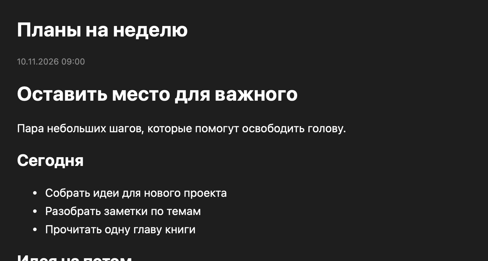

<p align="center"></p>

<p align="center"><a href="https://github.com/kip0VV/SimpleNotes/releases/latest"><strong>Скачать приложение</strong></a> · <a href="#установка">Установка</a> · <a href="#под-себя">Настройка</a> · <a href="#сборка-из-исходников">Сборка</a></p>

SimpleNotes — небольшой нативный блокнот для Mac. Создавай заметки, собирай их по темам и возвращайся к нужной мысли через поиск или историю. Записи хранятся обычными файлами в выбранной тобой папке.

**macOS 13 Ventura и новее · Apple Silicon и Intel · Русский интерфейс**

## Установка

1. Скачай `SimpleNotes-0.3.2-universal.dmg` из [последнего релиза](https://github.com/kip0VV/SimpleNotes/releases/latest).
2. Открой образ и перетащи **SimpleNotes** в **Applications / Программы**.
3. Запусти приложение и выбери или создай папку для своих заметок.
4. Нажми **+ Новая заметка**, введи название и текст. **⌘Enter** сохранит запись.

В релизе также есть ZIP с приложением для ручной установки.

### Первый запуск и macOS

Эта сборка имеет локальную ad-hoc подпись и пока проходит распространение без Developer ID и нотариализации Apple. Если macOS заблокирует первый запуск, после попытки открытия зайди в **Системные настройки → Конфиденциальность и безопасность** и используй **«Всё равно открыть»**, если доверяешь этому релизу. Подробности приведены в [инструкции Apple](https://support.apple.com/ru-ru/102445).

## Что внутри

| Возможность | Как это работает |
| --- | --- |
| Темы и вложенные папки | Дерево справа повторяет структуру папок на диске. У каждой темы показано число записей, включая подпапки. |
| Поиск с контекстом | Поиск по названиям и тексту. Под результатом — фрагмент первого совпадения с подсветкой. |
| Задачи | Интерактивные галочки `[ ]` / `[x]` в предпросмотре. Чистая сохранённая заметка записывается сразу, черновые изменения сохраняются общей кнопкой. |
| Масштаб | Лупа, − / + и процент снизу. Текст редактора и предпросмотр от 50% до 200%, уровень сохраняется. |
| Markdown | Компактные значки жирного, курсива, списка, задач и ссылки; заголовки, нумерация, цитаты и код — в «Ещё». Жирный, курсив, задачи, цитаты, код, ссылки и рендер Markdown и формул LaTeX. |
| Недавние записи | Компактная история последних открытых и сохранённых заметок. |
| Цвета | Правый щелчок по записи или папке → **Цвет**. |
| Порядок | Перетаскивай элементы между соседними строками. Линия вставки плавно привязывается к ближайшему месту. |
| Управление файлами | Переименование, копирование, перенос, создание подпапок и удаление в Корзину через контекстное меню. |
| Черновик | Незаконченный текст сохраняется между запусками. Перед переходом к другой записи появляется выбор сохранения. |
| Напоминания | Дата, время и повтор каждый час, день, неделю или месяц. По умолчанию три ближайших напоминания показаны над «Обновить список». Потяни верхнюю границу блока вверх, чтобы видеть больше записей, или вниз до минимума, чтобы скрыть его. В **⋯ → Основные → Напоминания** галочка **«Скрыть меню напоминаний»** позволяет вручную скрывать и возвращать блок. Высота и видимость сохраняются. Кнопка «Все…» открывает полный список с поиском, фильтрами и сортировкой, из которого можно открыть заметку, изменить время и повтор или отменить напоминание. |
| Быстрая заметка | **⌘N** внутри приложения и настраиваемая системная команда, запускающая полностью закрытый SimpleNotes. |



*Markdown-предпросмотр. На изображении используются демонстрационные записи.*

## Под себя

Открой **⋯** внизу правого меню или нажми **⌘,**. Настройки открываются отдельным окном с вкладками **«Основные»** и **«Горячие клавиши»**. Во второй вкладке можно назначить сочетания для 36 действий — заметок, навигации, масштаба, форматирования, файлов, напоминаний и оформления. Есть проверка конфликтов и восстановление стандартных сочетаний. Изменения сохраняются сразу.

В разделе «Папка заметок» виден текущий путь. Здесь можно выбрать другую папку, создать новую через стандартный диалог macOS или открыть текущую в Finder. Для свайпов доступно обратное направление.

- Выбери системную, светлую, тёмную или тему «Графит · мягкий голубой».
- Включи автоскрытие боковой панели и показ даты.
- Назначь сочетание **«Быстрая заметка»**, чтобы создавать записи из других приложений. Системная служба **«Новая заметка в SimpleNotes»** запускает приложение даже после полного выхода через ⌘Q. При первом запуске служба регистрируется автоматически, отдельную команду создавать не требуется. Сочетания, занятые меню текущего приложения, могут перехватываться этим приложением.
- Включи **«Уведомления о заметках»**. При первом включении macOS запросит разрешение.
- Открой папку текущей темы, всю библиотеку или выбери другую папку заметок. Файлы прежней библиотеки останутся в исходном месте.

Перетаскивай вертикальную границу для ширины меню и горизонтальную ручку для масштаба верхней панели. Маленькая ручка справа от выбора темы меняет размер самого выбора и кнопки **+ Тема**. Размеры, тема, порядок и раскрытые папки сохраняются.

Рендер заметки создаётся при первом открытии и переиспользуется. Чтение файлов для поиска выполняется в фоновой очереди, тексты неизменённых заметок берутся из кэша. Список тем читает только структуру папок.

## Клавиши и жесты

В таблице указаны стандартные сочетания. Свои варианты задаются в настройках, работают при русской раскладке по физической клавише.

| Действие | Управление |
| --- | --- |
| Новая заметка | **⌘N** |
| Сохранить | **⌘Enter** |
| Поиск по заметкам | **⌘F** |
| Увеличить / уменьшить масштаб | **⌘+ / ⌘−** |
| Вернуть масштаб 100% | **⌘0** |
| Жирный / курсив / ссылка | **⌘B / ⌘I / ⌘K** |
| Предпросмотр / редактор | **⌘⇧P / ⌘E** |
| Открыть правое меню | Свайп двумя пальцами влево внутри окна или кнопка **Меню** |
| Скрыть правое меню | Свайп двумя пальцами вправо или **Скрыть меню** |
| Показать скрытую панель | Наведение к правому краю |
| Изменить порядок | Перетаскивание между строками при очищенном поиске |
| Вложить в другую папку | **Option + перетаскивание** или **Переместить в…** в контекстном меню |
| Переименовать, покрасить, удалить | Правый щелчок по записи или папке |

## Хранение записей

Темы — папки, новые заметки — файлы `.md`. Приложение также открывает `.txt` и `.markdown`. Внутри созданного файла находятся название, дата, тема и текст. Имя файла берётся из названия, а при совпадении добавляется номер.

Свою библиотеку можно копировать и открывать другими редакторами. Настройки интерфейса, история и напоминания сохраняются в пользовательских настройках macOS. При удалении используется системная Корзина.

## Сборка из исходников

Понадобятся Mac и Command Line Tools for Xcode.

```sh
xcode-select --install
git clone https://github.com/kip0VV/SimpleNotes.git
cd SimpleNotes
./scripts/build.sh --native
open build/SimpleNotes.app
```

Универсальная сборка для обеих архитектур и установочные архивы создаются одной командой.

```sh
./scripts/package.sh
```

Проверки сохранения, черновиков, файловых операций, поиска, кэша, фонового обновления, настроек, всех 39 назначений клавиш, форматирования и настоящего WebKit-предпросмотра запускаются командой `./scripts/test.sh`. Подробности покрытия приведены в [отчёте проверки](testing.md).

Результаты появятся в `build/`. Сборка использует системные Swift, AppKit, WebKit, Carbon и UserNotifications. Markdown-рендерер включён в ресурсы приложения.

## Структура проекта

```text
Sources/SimpleNotes/
  main.swift                    Запуск приложения
  NotesApp.swift                Окно, заметки и файловые операции
  InteractionViews.swift        Панели, перетаскивание и жесты
  NoteNode.swift                Дерево папок и записей
  NoteIndex.swift               Фоновое чтение библиотеки и поиск
  MarkdownPreview.swift         WebKit-рендер Markdown и LaTeX
  RemindersAndShortcuts.swift    Напоминания и горячие клавиши
Resources/                      Иконка, описание приложения, Markdown и KaTeX
scripts/                        Сборка, упаковка и проверки
Tests/                          Регрессионные проверки
ThirdPartyLicenses/              Лицензии зависимостей
```

## Статус версии

Текущая версия **0.3.2**. Сборка и интерфейс проверяются на Apple Silicon с macOS 26.3. Intel-сборка компилируется для macOS 13+, её запуск на реальном Intel Mac ещё требует проверки. Свайпы на физическом тачпаде, выбор папки и доставка системного уведомления подтверждены пользователем на этом Mac. Переход по уведомлению ещё требует проверки.

Ошибки и идеи можно прислать через [Issues](https://github.com/kip0VV/SimpleNotes/issues). Для ошибки укажи версию macOS, тип Mac и последовательность действий.

### Сторонние компоненты

Markdown-рендеринг использует **markdown-it 14.1.0**. Его MIT-лицензия сохранена в [ThirdPartyLicenses/markdown-it.txt](../ThirdPartyLicenses/markdown-it.txt).

## Быстрая запись и стиль редактора

Системная горячая клавиша всегда открывает компактную быструю запись с курсором в тексте. Сверху — папка и «⋯», снизу — статус сохранения. Форматирование находится в «⋯». Название берётся из первой строки; текст автоматически сохраняется после короткой паузы и перед переходом или закрытием. **⋯ → Открыть обычное окно** или **⌘⇧Enter** разворачивает ту же заметку без потери текста. Сочетание меняется в настройках. При ошибке записи черновик остаётся в приложении.

В **Настройки → Основные → Оформление** доступны выбор шрифта и размера, загрузка и сброс стиля. Это оформление текста для всех заметок, оно не меняет Markdown-файлы. Размер шрифта — 10–28 пунктов, масштаб задаётся отдельно. Стиль применяется к редактору и предпросмотру.

Свой стиль можно сохранить как файл `.json` и загрузить рядом с выбором темы:

```json
{
  "fontName": "Menlo-Regular",
  "fontSize": 16,
  "background": "#20242B",
  "foreground": "#E8EAF0"
}
```

Цвета необязательны: без них используются системные. Указанный шрифт должен быть установлен на Mac. Настройка расположения элементов интерфейса пока не добавлена.

## Рендер заметки и обновление библиотеки

Переключатель **Рендер** (⌘⇧P) показывает оформленный текст Markdown и математические формулы LaTeX. Поддерживаются `$…$`, `$$…$$`, `\(…\)` и `\[…\]`; формулы внутри кода остаются текстом. KaTeX и шрифты включены в приложение, интернет не нужен. Поддерживаются команды KaTeX, а не полный набор пакетов LaTeX. Исходный файл при отрисовке не меняется.

**⌘R** и кнопка **Обновить список** перечитывают структуру папок и заметки. Кнопка показывает «Обновление…», затем «✓ Обновлено»; под поиском появляется время завершения (если нет поискового запроса). Это обновляет библиотеку, открытый текст редактора не заменяется. Детали реализации — в [архитектуре](architecture.md).

## Поиск в открытой заметке

**⌘F** переводит фокус в поле под переключателем **Редактор / Рендер**. Совпадения подсвечиваются, счётчик показывает текущий результат и общее число. Стрелки, Enter / Shift+Enter и ⌘G / ⌘⇧G циклически переходят вперёд и назад. Поиск работает по исходному тексту редактора или отображаемому тексту рендера. Escape очищает поиск. Справа остаётся поиск по всей библиотеке: горячая клавиша для него по умолчанию не назначена, её можно выбрать в настройках.

Файлы «Без папки» обозначены значком блокнота, файлы внутри папок — значком листа.
